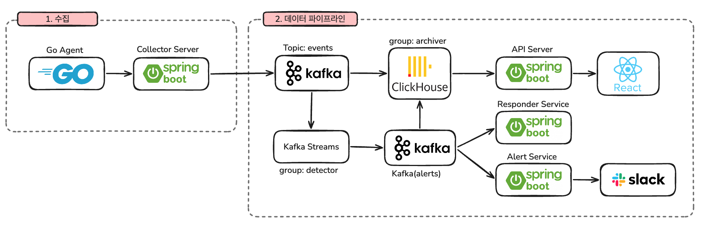

# EDRdog

회사 PC(Windows, macOS)의 행위 로그로 공격을 탐지하고, 확인을 거쳐 해당 프로세스를 종료하는 EDR 서비스입니다.

단국대학교 소프트웨어학과 졸업작품 · 김동현 (32210492)

## 제출 자료

| 자료 | 링크 |
|---|---|
| 시연 영상 | [YouTube](https://youtu.be/PuvhkB27s3s) |
| 발표자료 | [발표자료.pdf](https://github.com/EDRdog/.github/blob/main/docs/발표자료.pdf) |
| 포스터 | [포스터.pdf](https://github.com/EDRdog/.github/blob/main/docs/포스터.pdf) |
| 결과보고서 | [결과보고서.pdf](https://github.com/EDRdog/.github/blob/main/docs/결과보고서.pdf) |

## 프로젝트 결과물

| 저장소 | 내용 |
|---|---|
| [Backend](https://github.com/EDRdog/Backend) | 수집 에이전트(Go), 탐지·대응·알림 서버, 배포 설정, 개발 문서(`docs/`) |
| [Frontend](https://github.com/EDRdog/Frontend) | 웹 콘솔, 개발 문서(`docs/`) |

- 데모: https://edrdog.duckdns.org (로그인 없이 예시 데이터로 볼 수 있습니다)
- 실행 방법과 개발 문서는 각 저장소의 README와 `docs/` 를 참고하세요.

## 아키텍처

